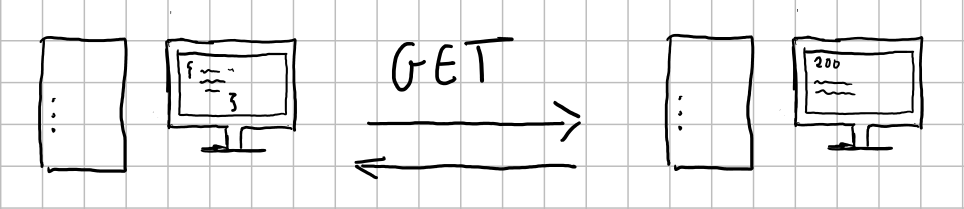
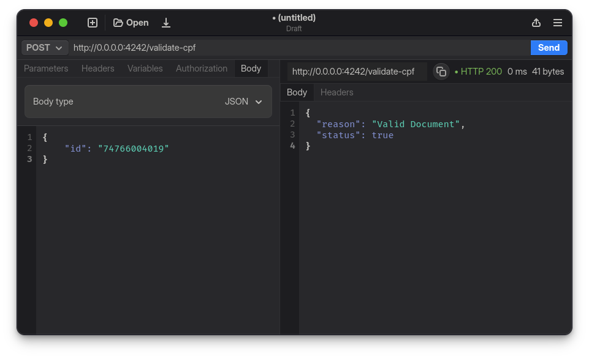
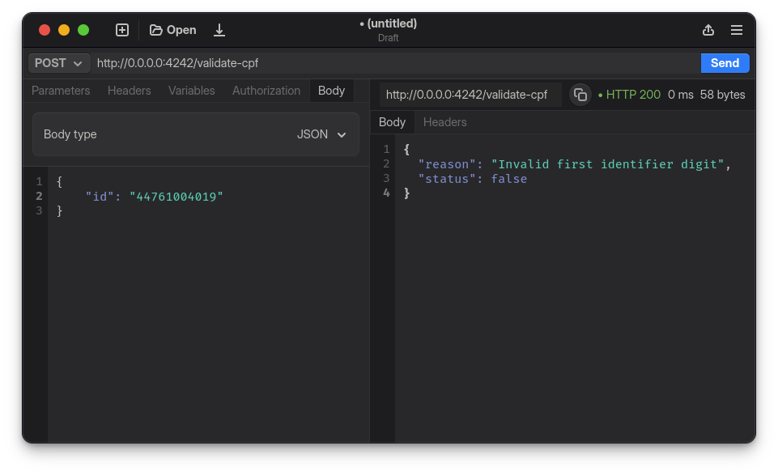

# Smolblackcat Learns: REST API Design



This repository is a constant work in progress as it serves as a tracking system
on my current abilities on the topic. I hope my notes may be useful for someone.

A personal rule I follow is that ***I can only use AI to write my code if I can
reason about it later***. In this case, I will make as many mistakes as I need
in order to properly learn the concept, and when I feel confident that I can
explain at least 88% well, then I am allowed to use AI to increase my
productivity.

## Introduction

A RESTful API is a web service that utilise the HTTP protocol methods to provide
an idiomatic interface for transferring states from client to server and
vice versa.

In this little project, I present a simple API that verifies whether a
Brazilian CPF is valid or not, and when the document sent is not a valid CPF,
the API will also include a reason description.

## Structure and Design

Despite the project's simplicity, I have decided to make good use of the best
practises of software development, which includes:

* **Code Modularisation**
* **Development Environment Isolation (Docker)**
* **Unit Tests**

I have used C++ along with [Crow Microframework](https://crowcpp.org/master/)
for the overall HTTP connection handling. The main reason of why I have chosen
C++ as the main language is because it is a language that I am more proficient
at.

## Endpoints

* **POST /validate-cpf** — Send a document for the server to validate

    ```json
    // Message Schema
    {
        "id": "document"
    }

    // Response Schema
    {
        "status": true,
        "reason": "Document Valid" // Detailed description of the status
    }
    ```

## What I have learned so far and what I still want to learn

* In the same as it is with code, the endpoints, and their methods should expose
the behaviour by itself, this can be done by using the appropriate
**Status Codes** and **HTTP Methods (i.e., GET, POST, PATCH, DELETE)**;

* There must be some way of writing automated tests for the API itself.
Currently, I am only testing the services the API offer, but I am not testing
for any Status code or specific output from the API;

* Connect an actual database to the API, and make a slightly complex system;

* Deploy the API into a docker container

## Building and Running

The following instructions assume a Debian-based operating system, but due to
the project's simplicity, porting for other operating systems is as easy as
typing out some commands. However, make sure that the essentials such as
compilers, build systems, and git are installed before proceding.

### Dependencies

* libasio-dev
* Crow (built-in)
* Catch2 (built-in)

### Instructions

1. Clone the repo

    ```sh
    # Platform independent. Make sure you have git installed
    git clone https://github.com/smolBlackCat/smolblackcat-learns-api.git
    ```

2. Configure the project

    ```sh
    # Platform independent. Make sure you have git installed
    cd smolblackcat-learns-api/
    mkdir build
    # Add -DENABLE_TEST=ON in case you want to run the tests
    cmake -S . -B build -DCMAKE_BUILD_TYPE=Release
    ```

3. Build

    ```sh
    cmake --build build
    ```

4. Run

    ```sh
    build/gov-api
    ```
### Demonstration





## Next Steps

1. Integrate a relational database (which it will require database design)
2. Configure a docker image
