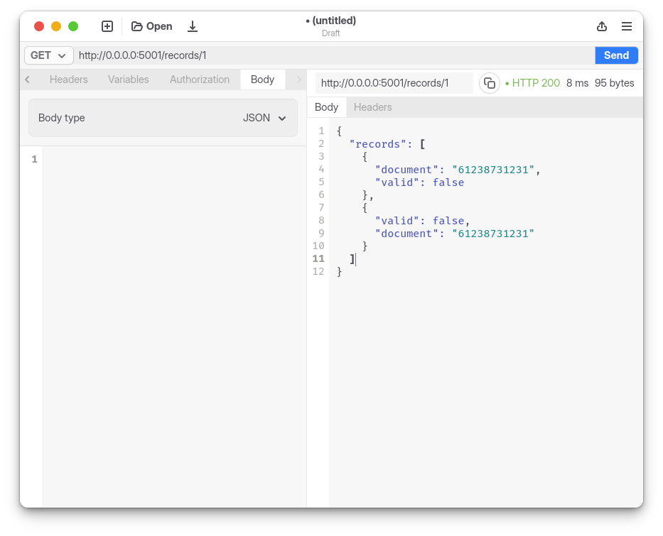

# Smolblackcat Learns: REST API Design


This repository is a constant work in progress as it serves as a tracking system
on my current abilities on the topic. I hope my notes may be useful for someone.

A personal rule I follow is that ***I can only use AI to write my code if I can
reason about it later***. In this case, I will make as many mistakes as I need
in order to properly learn the concept, and when I feel confident that I can
explain at least 88% well, then I am allowed to use AI to increase my
productivity.

## Introduction

A RESTful API is a web service that utilise the HTTP protocol methods to provide
an idiomatic interface for transferring states from client to server and
vice versa.

In the previous version, the API consisted of a single POST endpoint for sending
documents to be validated, and receiving their validation description and
status. In this iteration, the API is connected to a database in order to log
all document validation requests, and provide a new GET endpoint for reading all
the document validation requests made.

## Structure and Design

Since the addition of a database to the system, there was a need for clearly
defining the system's services:

* Database Service;
* API

The approach taken to organise the source code was to define all the system's
services as containers in a docker compose file. What once took a few keystrokes
for setting up the environment, has been reduced to a single docker compose
command.

```sh
docker compose up
```

## Endpoints

* **POST /validate-cpf** — Send a document for the server to validate

    ```json
    // Message Schema
    {
        "id": "document"
    }

    // Response Schema
    {
        "status": true,
        "reason": "Document Valid" // Detailed description of the status
    }
    ```

* **GET /records/<int>** - Retrieve all documents that have been validated by the API

    ```json
    {
        "records": [
            {
             "document": "xxxxxxxxxxx",
             "valid": false
            }
            ...
        ]
    }
    ```

## What I have learned so far and what I still want to learn

* I have learned the importance of having a well-defined development
environment. Packaging the API as a collection of docker containers made
testing and deploying the system easier;

* I have also learned the basics of database-api communication.

* The current environment configuration is sufficient, but it can be improved.
The first thing to improve is how the project deal with secrets, and this can
be seem in how the API database user is defined in the schema (see api-db)

* The idea of having an endpoint that reads all the information is interesting,
however, not everyone should be able to read this sort of information.
Therefore, there must be a way of **authenticating** API users before letting
them access the endpoints.

## Building and Running

Given the new structure, the easiest way of building this project is by
installing it in a container via docker compose. Before building,
**define a .env file containing the database's ROOT password**:

```env
DB_ROOT_PASSWORD=your-password-here
```

### Instructions

1. Clone the repo

    ```sh
    # Platform independent. Make sure you have git installed
    git clone https://github.com/smolBlackCat/smolblackcat-learns-api.git
    ```

2. Build the containers

    ```sh
    # Run the system in detached mode
    docker compose up -d
    ```

All done, the api will be listening at `0.0.0.0:5001`.

### Demonstration




## Next Steps

1. Study the architecture for API and database communication
2. Automate API testing
3. Implement authentication